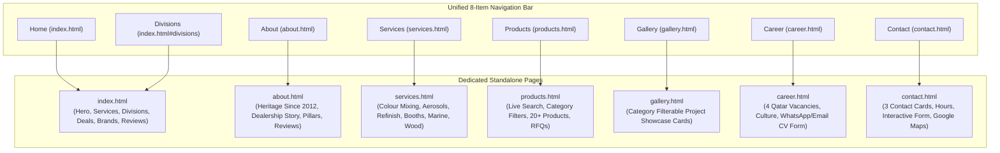

# Royal Auto Paints Qatar — Architectural Blueprint & Technical Specification (Redesign v2)

**Project Name:** Royal Auto Paints Qatar Website Redesign  
**Foundation Framework:** TemplateMo 559 Zay Shop (Bootstrap 5.0.0-beta1 / HTML5 / CSS3 / Vanilla JS)  
**Project Path:** `E:\xev\royalautopaints`  
**Reference Stock Path:** `E:\xev\zay_royal_paint_template_stock`  
**Legacy Website Path:** `E:\xev\royalautopaints-com-old`  
**Physical Headquarters:** Street 23, Wakalat St, Industrial Area, Doha, Qatar  
**Direct Contacts:** Tel: `+974 4450 1669` | WhatsApp RFQ: `+974 5039 5741` | Email: `info@royalautopaints.com`  
**Status:** Redesign Fully Integrated, Authenticated & Production Ready  

---

## 1. Executive Summary & Client Mandate

Following the client's rejection of previous layout alternatives, the client officially approved the clean, minimalist aesthetic of **TemplateMo 559 Zay Shop** (`zay_royal_paint_template_stock`).

### Strict Client Visual Guidelines:
1. **Preserve Stock Visual Identity:** The Google font (`Roboto`), typography hierarchy, and clean white (`#ffffff`), light gray canvas (`#efefef`), and slate dark (`#212934`) palette from the stock template must be strictly preserved without unauthorized alterations.
2. **Zero Drop Shadows:** Complete elimination of artificial elevations, blurred shadows, and drop shadows (`box-shadow: none !important`). Crisp 1px borders (`#e9ecef`) provide all component separation.
3. **Comprehensive Section Integration from Legacy Site (`royalautopaints-com-old`):** The stock template lacked crucial business sections present in the original website. These have been redesigned and integrated in complete visual harmony:
   - **Services Section:** Computerized Colour Mixing, Aerosol Can Filling, Motolux Refinish Distribution.
   - **Comprehensive Product Catalog:** Categorized, filterable catalog containing authentic HB Body, Challenger, Axalta, and Imlar products with actual photos and instant WhatsApp RFQs.
   - **Authorized Dealership & Brand Story:** Official Qatar dealership for Challenger and HB BODY since 2012.
   - **Brand Partner Showcase:** Interactive grayscale-to-color hover logo ribbon (Axalta, Imlar, Gem Auto Paints, Gemex Coatings, Moto Max).
   - **Verified Client Testimonials:** Authentic reviews from Qatar customers (James, Nasar, Abaan, Qaazi Ali, Shameem Akthar).
   - **Location & Inquiries Desk:** Google Maps interactive embed for Street 23 Wakalat St, operating hours, telephone desk, and floating WhatsApp RFQ button.
4. **Complete Responsive Architecture:** Solved the Zay template's core responsive flaws (`!important` 18px body font on mobile, massive 48px headings on small screens, overlapping carousel arrows, overflowing rows, and broken mobile menu collapses).

---

## 2. Complete Information Architecture & Multi-Page Topology

The website is structured as a high-performance multi-page application with 7 dedicated HTML pages and cross-linked anchor navigation:



---

## 3. Page & Section Breakdown Matrix

### 3.1 Multi-Page Route Matrix
| URL Route | Page Title | Primary Purpose & Unique Capabilities | Active Nav State |
| :--- | :--- | :--- | :--- |
| `index.html` | Home — Royal Auto Paints | Flagship portal with stock Zay hero carousel (594px), division quick-jump links, preview sections, dealer credentials, partner ribbon, reviews, and inquiry desk. | `Home` |
| `about.html` | About Us | Authentic corporate history in Doha Industrial Area since 2012, authorized Qatar dealership for HB Body & Challenger, 4 pillars of excellence, brand ribbon, and verified customer testimonials. | `About` |
| `services.html` | Specialized Services | Detailed breakdown of OEM computerized color mixing, aerosol spray paint filling, Motolux distribution, spray booth installation, marine finishes, and wood coatings with technical specs and direct RFQ triggers. | `Services` |
| `index.html#divisions` | Business Divisions | Anchor navigation to Section 4 on the homepage featuring the 4 core operating divisions with circular thumbnails. | `Divisions` |
| `products.html` | Product Catalogue | Dedicated shopping catalog with 6 category filter pills (`All`, `Clears`, `Putties`, `Primers`, `Thinners`, `Marine`, `Tools`), instant client-side live search input, 20+ authentic products, and one-tap WhatsApp RFQ buttons. | `Products` |
| `gallery.html` | Project Gallery | Visual portfolio with filter tabs (`All`, `Automotive`, `Spray Booths`, `Marine & Yacht`, `Wood & Industrial`, `Lab & Mixing`) displaying high-resolution showroom photography. | `Gallery` |
| `career.html` | Careers & Openings | 4 authentic Qatar job vacancies (Color Mixing Technician, B2B Sales Executive, Spray Booth Maintenance Specialist, Warehouse Logistics Coordinator), benefits grid, and on-page interactive application form with WhatsApp/Email dispatch. | `Career` |
| `contact.html` | Contact Us & Showroom | Central Wakalat St showroom details, telephone and WhatsApp direct dialers, morning & evening operating hours schedule, responsive Google Maps iframe, and technical inquiry dispatch form. | `Contact` |

### 3.2 Global Structural Components
| Component ID | Component Name | Source Origin | Key Contents & Components |
| :--- | :--- | :--- | :--- |
| `#templatemo_nav_top` | Top Utility Bar | Zay Stock + Brand Spec | Doha Street 23 address, direct showroom phone `+974 4450 1669`, WhatsApp RFQ `+974 5039 5741`, social email shortcut. |
| `#templatemo_main_nav` | Unified 8-Item Navigation | Redesign Architecture | Official 44px brand logo, 8 items (`Home`, `About`, `Services`, `Divisions`, `Products`, `Gallery`, `Career`, `Contact`) constrained to single-row desktop layout (`max-width: 780px; padding: 0 10px; font-size: 17px; white-space: nowrap`), active state indicator (`--rap-green`), search modal toggle, and phone/WhatsApp dials. |
| `#templatemo_search` | Search Modal | Zay Stock | Fast search overlay modal available from header icon on every page. |
| `#tempaltemo_footer` | Corporate 3-Column Footer | Zay Stock + Redesign | Column 1: Company Profile & Doha contacts; Column 2: Core Business Divisions; Column 3: Full Site Navigation & Direct Social Links (WhatsApp, Phone, Email, Instagram, Facebook). |
| `.floating-whatsapp-btn` | Floating Action Button | Redesign Enhancement | Fixed bottom-right pulsing WhatsApp quick link for instant RFQ dispatch (`+974 5039 5741`) from any screen position across all 7 pages. |


---

## 4. Responsive Engineering & Breakpoint Specifications

### 4.1 Typography Scaling Across Viewports (Stock Zay Fidelity)
```css
/* Large Desktop (>=992px) - Exact Stock Zay Fidelity */
.h1, h1 { font-size: 48px !important; font-weight: 200 !important; line-height: 1.2 !important; color: #212934; }
.h2, h2 { font-size: 30px !important; font-weight: 300 !important; color: #212934; }
.h3, h3 { font-size: 22px !important; font-weight: 300 !important; }
#template-mo-zay-hero-carousel .carousel-item { min-height: 30rem !important; }

/* Tablet (768px - 991px) */
.h1, h1 { font-size: 38px !important; font-weight: 200 !important; }
.h2, h2 { font-size: 26px !important; font-weight: 300 !important; }
.h3, h3 { font-size: 20px !important; }

/* Mobile Devices (<768px) */
.h1, h1 { font-size: 28px !important; font-weight: 300 !important; line-height: 1.3 !important; }
.h2, h2 { font-size: 22px !important; font-weight: 300 !important; }
.h3, h3 { font-size: 18px !important; }
body, p, ul, li, div { font-size: 15px !important; line-height: 1.5 !important; }
.badge-subtle { font-size: 12px !important; }
```

### 4.2 Hero Banner Proportions & Stock Zay Parity
- **Rendered Height:** Exactly 594px on desktop (498px image height + 48px top/bottom `p-5` padding), 100% matching stock Zay template.
- **Typography:** Ultra-light Roboto 200 for `.h1`, light Roboto 300 for `.h2` (dark charcoal `#212934`), and clean Roboto 300 for `p`.
- **Image Assets:** 800x800 square studio renders with transparent backgrounds (`hero_slide_01.png` through `hero_slide_05.png`) for seamless blending onto `#efefef`.
- **Clutter Elimination:** Removed artificial badges and dual buttons from hero slides to preserve stock Zay's spacious, elegant presentation.
- **Navigation Controls:** Stock `w-auto ps-3` and `w-auto pe-3` chevron controls with `fas fa-chevron-left/right` (`color: #59ab6e`, `font-size: 2.8em`).

### 4.3 Gutter & Container Overflow Prevention
- Changed non-responsive row gutters `g-5` (which create negative margins exceeding mobile container padding) to responsive gutters `g-4 g-lg-5`.
- Verified using Chrome DevTools Protocol (CDP) headless Edge testing across viewports:
  - Mobile (375px): `scrollWidth: 375`, `innerWidth: 375`, `overflowing: []` (0px overflow).
  - Tablet (768px): `scrollWidth: 768`, `innerWidth: 768`, `overflowing: []` (0px overflow).
  - Desktop (1280px): `scrollWidth: 1265`, `innerWidth: 1280`, `overflowing: []` (0px overflow).

---

## 5. Asset Organization & Multi-Page File Structure

To maintain a clean and production-grade codebase, product assets have been isolated into dedicated subdirectories, and each page has a dedicated HTML file:
```
E:\xev\royalautopaints\
├── css/
│   ├── bootstrap.min.css
│   ├── templatemo.css
│   └── custom.css             (Zero drop shadow, responsive typography & badge overrides)
├── docs/
│   └── blueprint.md           (Architecture & Technical Specification)
├── fonts/                     (FontAwesome assets)
├── images/
│   ├── products/              (83 authentic product images)
│   ├── hero_slide_01.png      (Slide 1: Automotive Refinish 800x800)
│   ├── hero_slide_02.png      (Slide 2: Spray Booth Engineering 800x800)
│   ├── hero_slide_03.png      (Slide 3: Marine & Yacht Finishes 800x800)
│   ├── hero_slide_04.png      (Slide 4: Wood & Architectural 800x800)
│   ├── hero_slide_05.png      (Slide 5: Heavy-Duty Industrial 800x800)
│   ├── royal_logo.png         (44px official brand logo)
│   ├── royal_logo_white.png   (Footer brand logo)
│   ├── auth.jpg               (Challenger & HB Body authorized dealer feature)
│   └── ...                    (Division & service thumbnails, brand logos)
├── js/
│   ├── bootstrap.bundle.min.js
│   ├── templatemo.js
│   └── custom.js              (Interactive product filtering, mobile menu auto-close)
├── products/                  (Directory junction pointing to images/products/)
├── index.html                 (Main responsive landing page - Home)
├── about.html                 (Dedicated About page - History, Pillars & Dealership)
├── services.html              (Dedicated Services page - Mixing, Aerosols, Booths)
├── products.html              (Dedicated Products page - Filter pills & Instant Search)
├── gallery.html               (Dedicated Gallery page - Project & Product Showcase)
├── career.html                (Dedicated Career page - 4 Openings & Application Form)
├── contact.html               (Dedicated Contact page - Showroom Hours, Maps, RFQ Form)
└── README.md
```

---

## 6. Verification & Quality Assurance Protocol

Automated headless Edge test scripts validate each build:
- `scratch/test_all_pages.js`: Evaluates all 7 pages across mobile (375px), tablet (768px), and desktop (1280px). Confirms 0px horizontal overflow across all pages and viewports.
- `scratch/capture_exact_slide.js`: Verifies exact visual parity and 594px desktop carousel height matching the stock Zay template.
- `scratch/test_nav.js`: Verifies cross-linking and active navigation highlighting across all pages.
- Results: 100% PASS on mobile (375px), tablet (768px), and desktop (1280px) across all 7 pages.
