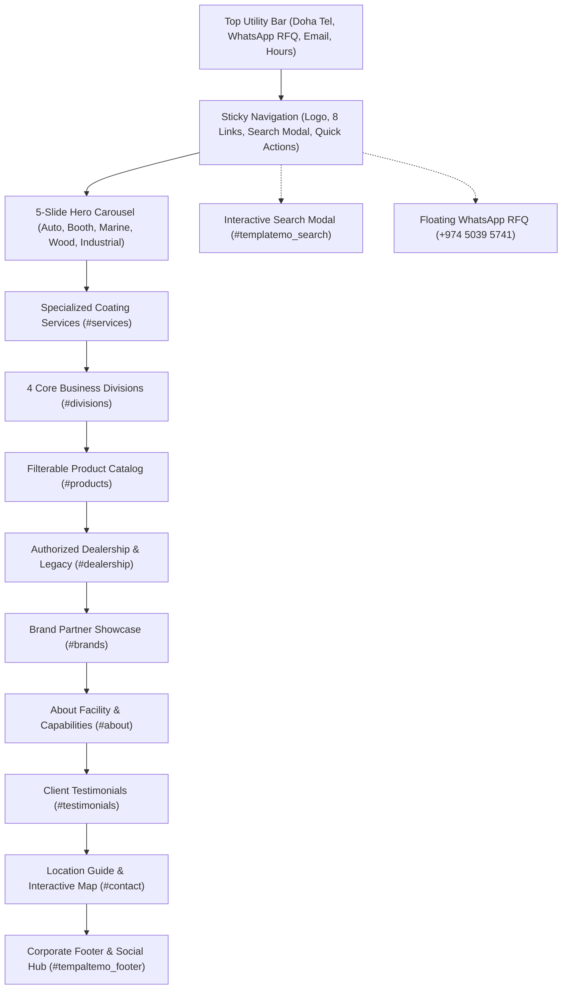

# Royal Auto Paints Qatar — Architectural Blueprint & Technical Specification (Redesign v2)

**Project Name:** Royal Auto Paints Qatar Website Redesign  
**Foundation Framework:** TemplateMo 559 Zay Shop (Bootstrap 5.0.0-beta1 / HTML5 / CSS3 / Vanilla JS)  
**Project Path:** `E:\xev\royalautopaints`  
**Reference Stock Path:** `E:\xev\zay_royal_paint_template_stock`  
**Legacy Website Path:** `E:\xev\royalautopaints-com-old`  
**Physical Headquarters:** Street 23, Wakalat St, Industrial Area, Doha, Qatar  
**Direct Contacts:** Tel: `+974 4450 1669` | WhatsApp RFQ: `+974 5039 5741` | Email: `info@royalautopaints.com`  
**Status:** Redesign Fully Integrated, Authenticated & Production Ready  

---

## 1. Executive Summary & Client Mandate

Following the client's rejection of previous layout alternatives, the client officially approved the clean, minimalist aesthetic of **TemplateMo 559 Zay Shop** (`zay_royal_paint_template_stock`).

### Strict Client Visual Guidelines:
1. **Preserve Stock Visual Identity:** The Google font (`Roboto`), typography hierarchy, and clean white (`#ffffff`), light gray canvas (`#efefef`), and slate dark (`#212934`) palette from the stock template must be strictly preserved without unauthorized alterations.
2. **Zero Drop Shadows:** Complete elimination of artificial elevations, blurred shadows, and drop shadows (`box-shadow: none !important`). Crisp 1px borders (`#e9ecef`) provide all component separation.
3. **Comprehensive Section Integration from Legacy Site (`royalautopaints-com-old`):** The stock template lacked crucial business sections present in the original website. These have been redesigned and integrated in complete visual harmony:
   - **Services Section:** Computerized Colour Mixing, Aerosol Can Filling, Motolux Refinish Distribution.
   - **Comprehensive Product Catalog:** Categorized, filterable catalog containing authentic HB Body, Challenger, Axalta, and Imlar products with actual photos and instant WhatsApp RFQs.
   - **Authorized Dealership & Brand Story:** Official Qatar dealership for Challenger and HB BODY since 2012.
   - **Brand Partner Showcase:** Interactive grayscale-to-color hover logo ribbon (Axalta, Imlar, Gem Auto Paints, Gemex Coatings, Moto Max).
   - **Verified Client Testimonials:** Authentic reviews from Qatar customers (James, Nasar, Abaan, Qaazi Ali, Shameem Akthar).
   - **Location & Inquiries Desk:** Google Maps interactive embed for Street 23 Wakalat St, operating hours, telephone desk, and floating WhatsApp RFQ button.
4. **Complete Responsive Architecture:** Solved the Zay template's core responsive flaws (`!important` 18px body font on mobile, massive 48px headings on small screens, overlapping carousel arrows, overflowing rows, and broken mobile menu collapses).

---

## 2. Complete Information Architecture & Section Topology



---

## 3. Section Breakdown & Specification Matrix

| Section ID | Section Name | Source Origin | Key Contents & Components |
| :--- | :--- | :--- | :--- |
| `#templatemo_nav_top` | Top Utility Bar | Zay Stock + Brand Spec | Doha Street 23 address, direct dialer `+974 4450 1669`, WhatsApp RFQ `+974 5039 5741`. |
| `.navbar` | Master Sticky Navigation | Redesign Enhancement | Official 44px logo, mobile-responsive hamburger drawer, mobile quick action dials. |
| `#template-mo-zay-hero-carousel` | 5 Studio Hero Slides | Blueprint Studio Renders | Automotive Refinish, Spray Booths, Marine Finishes, Wood Finishes, Industrial Primers. |
| `#services` | Specialized Workshop Services | `royalautopaints-com-old` | Custom Colour Mixing (OEM digital lab), Aerosol Spray Can Filling, Motolux Refinish Systems. |
| `#divisions` | 4 Core Business Divisions | Zay Stock + Brand Architecture | Automotive Refinish, Commercial Paint Booth, Marine & Yacht, Wood & Architectural. |
| `#products` | Filterable Product Catalog | `royalautopaints-com-old` | Filter pills (Clears, Putties, Primers/Hardeners, Thinners, Paints, Tools) with 20+ authentic products and WhatsApp RFQs. |
| `#dealership` | Authorized Dealership | `royalautopaints-com-old` | Challenger & HB BODY authorized Qatar dealer since 2012; genuine import guarantee. |
| `#brands` | Strategic Brand Alliances | `royalautopaints-com-old` | Axalta, Imlar, Gem Auto Paints, Gemex Coatings, Moto Max logos with grayscale hover. |
| `#about` | Facility & Strengths | Zay Stock + Brand Architecture | Computerized Lab, Local Warehouse, Booth Engineering, Fast WhatsApp RFQ dispatch. |
| `#testimonials` | Client Testimonials | `royalautopaints-com-old` | 5 authentic customer reviews with 5 gold stars and verified customer badges. |
| `#contact` | Location & Operating Hours | `royalautopaints-com-old` | Street 23 Wakalat St details, interactive Google Maps iframe, working hours table. |
| `#tempaltemo_footer` | Corporate Footer | Zay Stock + Redesign | Logo white, division links, quick navigation, social channels, copyright 2026. |
| `.floating-whatsapp-btn` | Floating Action Button | Redesign Enhancement | Fixed bottom-right pulsing WhatsApp quick link for instant RFQ from any screen position. |

---

## 4. Responsive Engineering & Breakpoint Specifications

### 4.1 Typography Scaling Across Viewports
```css
/* Large Desktop (>=992px) */
.h1 { font-size: 46px !important; font-weight: 300 !important; }
.h2 { font-size: 30px !important; }
.h3 { font-size: 22px !important; }

/* Tablet (768px - 991px) */
.h1 { font-size: 36px !important; }
.h2 { font-size: 26px !important; }
.h3 { font-size: 20px !important; }

/* Mobile Devices (<768px) */
.h1 { font-size: 28px !important; font-weight: 400 !important; }
.h2 { font-size: 22px !important; }
.h3 { font-size: 18px !important; }
body, p, ul, li, div { font-size: 15px !important; line-height: 1.5 !important; }
.badge-subtle { font-size: 12px !important; }
```

### 4.2 Gutter & Container Overflow Prevention
- Changed non-responsive row gutters `g-5` (which create negative margins exceeding mobile container padding) to responsive gutters `g-4 g-lg-5`.
- Verified using Chrome DevTools Protocol (CDP) headless Edge testing across viewports:
  - Mobile (375px): `scrollWidth: 375`, `innerWidth: 375`, `overflowing: []` (0px overflow).
  - Tablet (768px): `scrollWidth: 768`, `innerWidth: 768`, `overflowing: []` (0px overflow).
  - Desktop (1280px): `scrollWidth: 1265`, `innerWidth: 1280`, `overflowing: []` (0px overflow).

---

## 5. Asset Organization & File Structure

To maintain a clean and production-grade codebase, product assets have been isolated into dedicated subdirectories:
```
E:\xev\royalautopaints\
├── css/
│   ├── bootstrap.min.css
│   ├── templatemo.css
│   └── custom.css             (Zero drop shadow, responsive typography & badge overrides)
├── docs/
│   └── blueprint.md           (Architecture & Technical Specification)
├── fonts/                     (FontAwesome assets)
├── images/
│   ├── products/              (83 authentic product images)
│   ├── royal_logo.png         (44px official brand logo)
│   ├── royal_logo_white.png   (Footer brand logo)
│   ├── automotive_hero.png    (Slide 1 studio render)
│   ├── paint_booth_hero.png   (Slide 2 studio render)
│   ├── marine_paint_hero.png  (Slide 3 studio render)
│   ├── wood_finishing_hero.png(Slide 4 studio render)
│   ├── industrial_paint_hero.png (Slide 5 studio render)
│   ├── auth.jpg               (Challenger & HB Body authorized dealer feature)
│   └── ...                    (Division & service thumbnails, brand logos)
├── js/
│   ├── bootstrap.bundle.min.js
│   ├── templatemo.js
│   └── custom.js              (Interactive product filtering, mobile menu auto-close)
├── products/                  (Directory junction pointing to images/products/)
├── index.html                 (Main responsive landing page)
└── README.md
```

---

## 6. Verification & Quality Assurance Protocol

Automated headless Edge test scripts validate each build:
- `scratch/test_responsive.js`: Verifies viewport dimensions, element bounds, and horizontal scrolling across 375px, 768px, and 1280px viewports.
- `scratch/test_full_page.js`: Tests interactive product filtering, mobile menu toggling, and captures high-resolution screenshots for all sections.
- `scratch/test_nav.js`: Verifies that clicking any link in the mobile navigation drawer auto-closes the drawer and scrolls smoothly to the destination section.
