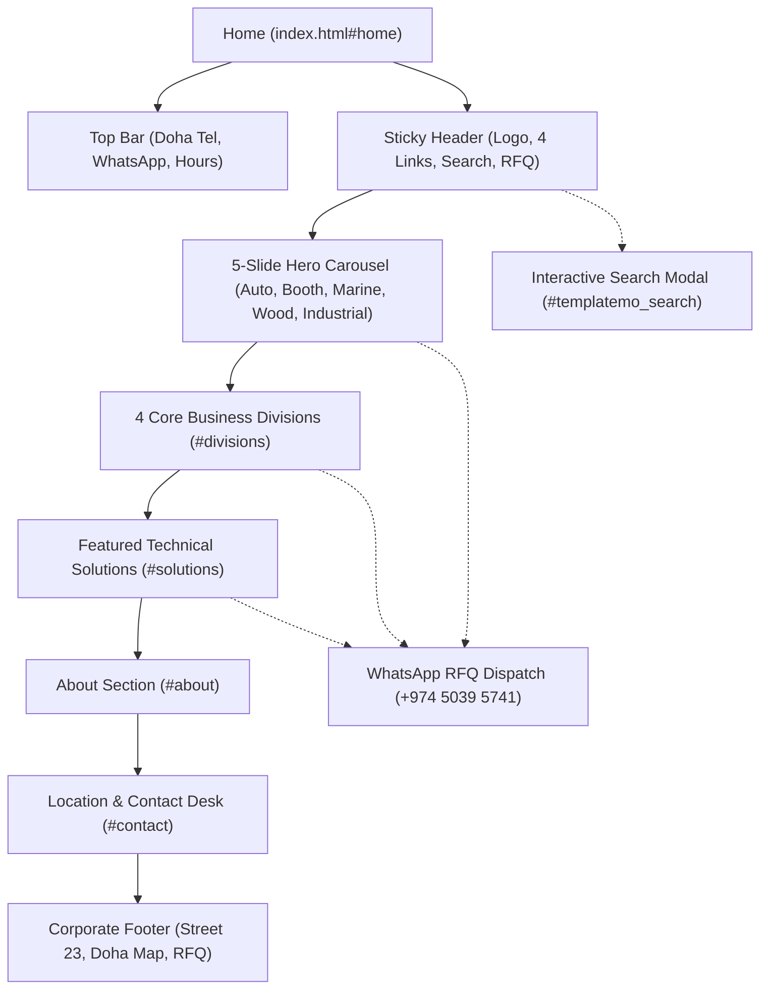

# Royal Auto Paints Qatar — Architectural Blueprint & Technical Specification

**Project Name:** Royal Auto Paints Qatar Website Redesign  
**Foundation Framework:** TemplateMo 559 Zay Shop (Bootstrap 5.0.0-beta1 / HTML5 / CSS3 / Vanilla JS)  
**Project Path:** `D:\manu\projects\royalautopaints`  
**Physical Headquarters:** Street 23, Wakalat St, Industrial Area, Doha, Qatar  
**Direct Contacts:** Tel: `+974 4450 1669` | WhatsApp RFQ: `+974 5039 5741` | Email: `info@royalautopaints.com`  
**Status:** Architecture Approved & Active in Production  

---

## 1. Executive Strategy & Commercial Scope

### 1.1 Commercial Transformation
Historically, Royal Auto Paints operated primarily as an automotive refinishing supplier. The objective of this enterprise web architecture is to reposition the brand as Qatar’s leading comprehensive commercial and industrial surface solutions provider across **five dedicated business divisions**:

1. **Automotive Refinish Division:** OEM computerized color matching, High-Solids (HS) clear coats, 2K primers, body putties, thinners, abrasives, and collision repair consumables.
2. **Commercial Paint Booth & Workshop Consumables:** Turnkey automotive & industrial spray booths, downdraft air filtration media, heating generators, high-efficiency extraction units, automotive-grade masking tapes, protective plastic films, and PPE respirators.
3. **Marine & Yacht Protective Finishes:** Heavy-duty anti-fouling coatings, marine epoxy barrier primers, high-gloss polyurethane yacht topcoats, and anti-corrosion barrier coatings formulated for extreme Arabian Gulf salinity and UV exposure.
4. **Wood & Architectural Industrial Finishes:** Premium polyurethane wood lacquers, non-yellowing clear coats, interior stains, sealers, and exterior architectural coatings for joinery, luxury interiors, and commercial developments.
5. **Heavy-Duty Industrial & Protective Coatings:** Industrial anti-corrosion metal primers, high-build epoxy thinners, structural steel coatings, and chemical-resistant industrial finishes engineered for harsh Middle Eastern climate conditions.

### 1.2 B2B Catalogue-Led RFQ Model
Rather than a consumer e-commerce cart/checkout model with pricing and delivery charges, Royal Auto Paints operates on a high-value B2B **Request for Quotation (RFQ)** model:
- **Direct WhatsApp RFQ Routing:** Instant, pre-formatted WhatsApp deep links allowing workshop managers, marine contractors, and industrial procurement officers to request quotes and technical data directly.
- **Direct Phone Dialers:** Accessible one-click tel-links for immediate technical desk inquiries (`+974 4450 1669`).
- **Interactive Search Modal:** Fast product lookup filtering products, divisions, clear coats, and equipment.

---

## 2. Design System & Visual Identity

### 2.1 The Flat Minimalist Mandate (Zero Drop Shadows)
Per executive design requirements, all artificial depth effects (drop shadows, blurred elevations) have been completely eliminated across the entire site. The design relies on clean borders, intentional whitespace, and razor-sharp typographic hierarchy:

```css
/* ==========================================================================
   Royal Auto Paints - Flat Minimalist Overrides (Zero Drop Shadows)
   ========================================================================== */
.navbar,
.card,
.btn,
img,
.shadow,
.shadow-sm,
.shadow-lg,
.product-wap {
    box-shadow: none !important;
    -webkit-box-shadow: none !important;
}

.navbar {
    border-bottom: 1px solid #e9ecef !important;
}

.card {
    border: 1px solid #e9ecef !important;
}
```

### 2.2 Color Architecture
- **Primary Brand Accent (Emerald / Jade Green):** `#59ab6e` (Hover: `#69bb7e`) — Used for primary CTAs, active badges, division highlights, and WhatsApp icons.
- **Primary Text & Headings (Charcoal / Slate):** `#212934` — Deep, high-contrast, professional typography.
- **Subtext & Secondary Information (Slate Gray):** `#6c757d` / `#333d4a`.
- **Hero Banner Canvas Background:** `#efefef` — Matches the soft-gradient fade of the studio product renders.
- **Top Utility Bar Background:** `#212934` (Dark Charcoal) — Provides strong grounding and high-contrast contact visibility.
- **Container / Card Surface:** `#ffffff` (Pure White).
- **Subtle Dividers & Outlines:** `#e9ecef`.

### 2.3 Typography Specifications
- **Font Family:** `Roboto`, sans-serif (imported via Google Fonts with weights `100`, `200`, `300`, `400`, `500`, `700`, `900`).
- **Navigation Links:** `Roboto:300` (Light), 18px font size with natural letter-spacing.
- **Display Headings (`h1`, `h2`):** `Roboto:300` with bold sub-accents (`b`, `fw-bold`), delivering an editorial luxury feel.
- **Badges & Micro-Copy:** `Roboto:500`, uppercase, 12px–13px with 1.5px letter-spacing.

---

## 3. Structural Layout & Navbar Architecture

### 3.1 Top Utility Bar (`#templatemo_nav_top`)
Fixed above the main header on large screens (`d-none d-lg-block`):
- **Location Badge:** `Street 23, Wakalat St, Industrial Area, Doha, Qatar` with map icon.
- **Telephone Link:** `+974 4450 1669` (`href="tel:+97444501669"`).
- **WhatsApp Link:** `+974 5039 5741` (`href="https://wa.me/97450395741..."`).
- **Social & Email Triggers:** One-click links for direct customer connectivity.

### 3.2 Master Navigation Header (`.navbar`)
- **Container Width:** Standard Bootstrap `.container` (`max-width: 1320px` on `xxl` viewports) ensuring edge-to-edge balance across widescreen monitors.
- **Brand Identity:** Left-aligned official logo (`images/royal_logo.png`) rendered at 44px height (`object-fit: contain`).
- **Navigation Menu (`#templatemo_main_nav`):**
  - Centered navigation list with `.navbar-nav.d-flex.justify-content-between.mx-lg-auto`.
  - Max-width locked to `550px` on desktop viewports (`@media (min-width: 992px) { #templatemo_main_nav .navbar-nav {max-width: 550px;} }`).
  - Standard 4 navigation items: **Home**, **About**, **Shop**, **Contact**.
- **Utility Actions (Right Flank):**
  - Search Modal Trigger (FontAwesome `fa-search`).
  - WhatsApp Direct Action (FontAwesome `fab fa-whatsapp text-success`).
  - Direct Phone Action (FontAwesome `fa-phone text-dark`).

---

## 4. Hero Carousel Architecture (`#template-mo-zay-hero-carousel`)

### 4.1 Native Proportion & Fluid Sizing
The carousel strictly adheres to the original template sizing logic:
- Desktop minimum height: `min-height: 30rem` defined in `css/templatemo.css`.
- Image Container: `<div class="mx-auto col-md-8 col-lg-6 order-lg-last text-center">`.
- Image Element: `` with **zero inline height overrides**.
- Background Canvas: `#efefef !important` — seamlessly blending with the soft-fade left gradient of the studio product renders.

### 4.2 The 5 Studio Banner Assets

```
+-----------------------------------------------------------------------------------------------+
| Slide 1: Automotive Refinish                                                                  |
| Asset: images/automotive_hero.png                                                             |
| Content: HB Body 698 HS Clear, Challenger Basecoat, HB Body F202 Zinc Plus, Sandpaper, Tapes    |
| Title: Qatar’s Premier Refinish Coatings                                                      |
| Subtitle: Computerized OEM Color Matching & HS Clears                                         |
+-----------------------------------------------------------------------------------------------+
| Slide 2: Commercial Paint Booth & Consumables                                                 |
| Asset: images/paint_booth_hero.png                                                            |
| Content: Gem Masking Tape, Dual-Cartridge Respirator, Paper Rolls, Plastic Film, HVLP Gun     |
| Title: Commercial Spray Booths & Consumables                                                  |
| Subtitle: Engineered Downdraft & Masking Systems                                              |
+-----------------------------------------------------------------------------------------------+
| Slide 3: Marine & Yacht Division                                                              |
| Asset: images/marine_paint_hero.png                                                           |
| Content: Sea-Line Marine Paint, Marine 2K Topcoat, Proo 638 Marine 2K Epoxy Primer, Brush     |
| Title: Marine & Yacht Protective Finishes                                                     |
| Subtitle: Formulated for Extreme Arabian Gulf Conditions                                      |
+-----------------------------------------------------------------------------------------------+
| Slide 4: Wood & Architectural Division                                                         |
| Asset: images/wood_finishing_hero.png                                                         |
| Content: Wood Paint Premium Finish, Wood Thinner, Wood Hardener, Hardwood Blocks, Brush       |
| Title: Wood & Architectural Industrial Finishes                                               |
| Subtitle: Polyurethane Lacquers, Stains & Sealers                                             |
+-----------------------------------------------------------------------------------------------+
| Slide 5: Industrial Coatings Division                                                         |
| Asset: images/industrial_paint_hero.png                                                       |
| Content: Industrial Coating, Industrial Thinner, Metal Primer, Steel I-Beam, HVLP Gun          |
| Title: Heavy-Duty Industrial Coatings & Primers                                               |
| Subtitle: Anti-Corrosion Metal Primers & Epoxy Systems                                        |
+-----------------------------------------------------------------------------------------------+
```

---

## 5. Information Architecture & Page Catalog

### 5.1 Route Mapping & Anchor Topology



### 5.2 Section Breakdown

| Section ID | Name | Layout Grid | Key Contents & Functionality |
| :--- | :--- | :--- | :--- |
| `#home` | Hero Carousel | 2-Column Responsive (`col-lg-6` text, `col-lg-6` img) | 5 studio product slides, pre-filled WhatsApp RFQs, division badges. |
| `#divisions` | Business Divisions | 4-Column Responsive (`col-lg-3` cards) | Automotive, Spray Booth, Marine, and Wood divisions with circular thumbnails and instant inquiry buttons. |
| `#solutions` | Featured Solutions | 3-Column Product Cards (`col-lg-4`) | Technical specifications, HS Clear Coats, Downdraft Filtration, and Marine Epoxy Primers. |
| `#about` | Company Overview | 2-Column Editorial | Doha Industrial Area warehouse capacity, computerized color mixing facilities, and brand distribution. |
| `#contact` | Contact & Inquiries | 2-Column Map + Details | Street 23 location guide, telephone desk, WhatsApp RFQ dispatch, business hours. |
| `footer` | Corporate Footer | 3-Column Global | Official logo white, division navigation, copyright, and verified location details. |

---

## 6. Complete Asset & Media Inventory

### 6.1 Core Hero Banner Graphics (`images/`)
- `automotive_hero.png` (1.50 MB): Studio render of automotive refinishing cans, sandpaper, masking tape.
- `paint_booth_hero.png` (1.55 MB): Studio render of Gem masking tape, respirator, spray gun, masking rolls, plastic wrap.
- `marine_paint_hero.png` (1.57 MB): Studio render of Sea-Line marine paint, 2K topcoat, 638 epoxy primer, application brush.
- `wood_finishing_hero.png` (1.59 MB): Studio render of wood paint, wood thinner, hardener, sample finished wood blocks, brush.
- `industrial_paint_hero.png` (1.73 MB): Studio render of industrial coating, thinner, metal primer, HVLP spray gun, steel I-beam.

### 6.2 Brand Identity Graphics
- `royal_logo.png` (60.5 KB): High-resolution official dark brand logo with custom typography.
- `royal_logo_white.png` (64.2 KB): High-contrast white version for the footer.
- `royal_favicon.png` (2.1 KB): 32x32 high-DPI browser tab icon.

### 6.3 Supporting Product Assets
- `royalpaint_hero_3.jpg` (243 KB): Division circular thumbnail for Automotive Refinish.
- `royalpaint_hero_booth.jpg` (634 KB): Division circular thumbnail for Spray Booth.
- `royalpaint_hero_marine.jpg` (770 KB): Division circular thumbnail for Marine & Yacht.
- `royalpaint_hero_wood.jpg` (667 KB): Division circular thumbnail for Wood & Architectural.

---

## 7. WhatsApp Integration & Lead Generation Matrix

Every division is equipped with deep-linked pre-filled WhatsApp URLs formatted for instant client context:

| Division / Feature | Destination Trigger | Pre-filled Message Text |
| :--- | :--- | :--- |
| **Top Nav / Header RFQ** | `+974 5039 5741` | `Hello Royal Auto Paints Qatar, I would like to request an RFQ` |
| **Slide 1: Automotive** | `+974 5039 5741` | `Hello Royal Auto Paints, I am inquiring about Automotive Refinish products` |
| **Slide 2: Paint Booth** | `+974 5039 5741` | `Hello Royal Auto Paints, I am inquiring about Commercial Paint Booths` |
| **Slide 3: Marine & Yacht** | `+974 5039 5741` | `Hello Royal Auto Paints, I am inquiring about Marine and Yacht Coatings` |
| **Slide 4: Wood & Arch** | `+974 5039 5741` | `Hello Royal Auto Paints, I am inquiring about Wood and Architectural Finishes` |
| **Slide 5: Industrial** | `+974 5039 5741` | `Hello Royal Auto Paints, I am inquiring about Industrial Coatings and Primers` |
| **Search Modal Fallback**| `+974 5039 5741` | `Hello Royal Auto Paints, I am inquiring about a product` |

---

## 8. Quality Assurance & Regression Prevention Protocol

### 8.1 Automated Verification Script
A dedicated headless Edge script (`verify_all_banners.js`) using the Chrome DevTools Protocol (CDP) validates every release:
- Tests viewport rendering at standard desktop resolutions (1400x900).
- Programmatically advances through all 5 carousel slides.
- Confirms image loading, container alignment, font sizes, and absence of visual glitches.
- Captures full-resolution verification screenshots saved directly to the artifact directory.

### 8.2 Strict Architectural Rules (No Regressions)
1. **Never Reintroduce Inline Heights on Banner Images:** Do not place `style="max-height: ..."` or `object-fit: cover` on hero banner images. The images must scale naturally via Bootstrap’s `.img-fluid`.
2. **Never Reintroduce Drop Shadows:** No `shadow`, `shadow-sm`, or `box-shadow` styles may be added. Flat minimalist borders (`1px solid #e9ecef`) must be maintained.
3. **Never Restrict the Navbar Container:** The navigation bar must always sit inside a standard `.container` with `.navbar-nav` constrained to `550px` on desktop.
4. **Preserve Authentic Doha Location:** Never alter Street 23, Wakalat St, Industrial Area, Doha, Qatar or the verified phone numbers (`+974 4450 1669`, `+974 5039 5741`).
