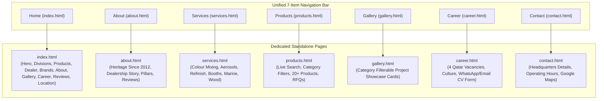

# Royal Auto Paints Qatar — Architectural Blueprint & Technical Specification (Redesign v2)

**Project Name:** Royal Auto Paints Qatar Website Redesign  
**Foundation Framework:** TemplateMo 559 Zay Shop (Bootstrap 5.0.0-beta1 / HTML5 / CSS3 / Vanilla JS)  
**Project Path:** `D:\manu\projects\royal_paints_1` (Active Workspace) / `D:\manu\projects\royalautopaints` (Primary Mirror) / `E:\xev\royalautopaints` (Multi-Device Remote Sync)  
**Reference Stock Path:** `E:\xev\zay_royal_paint_template_stock`  
**Legacy Website Path:** `E:\xev\royalautopaints-com-old`  
**Live Production Domain:** `https://www.royalautopaints.com/`  
**Physical Headquarters:** Street 23, Wakalat St, Industrial Area, Doha, Qatar  
**Direct Contacts:** Tel: `+974 4450 1669` | WhatsApp RFQ: `+974 5039 5741` | Email: `info@royalautopaints.com`  
**Status:** Redesign Fully Integrated, Authenticated & Production Ready (Sections 1–13 Complete)  

---

## 1. Executive Summary & Client Mandate

Following the client's rejection of previous layout alternatives, the client officially approved the clean, minimalist aesthetic of **TemplateMo 559 Zay Shop** (`zay_royal_paint_template_stock`), customized with the authentic corporate brand identity of Royal Auto Paints Qatar.

### Strict Client Visual & Business Guidelines:
1. **Royal Auto Paints Logo Brand Palette:** Swapped the stock generic template green (`#59ab6e`) with the authentic Royal Auto Paints logo color system: Primary Royal Oceanic Blue (`#09465f`), Brand Navy (`#142F50`), Paint Splash Warm Orange (`#f68c50`), Solar Gold (`#ffe05e`), and Slate Charcoal (`#58585a` / `#212934`) over a clean white (`#ffffff`) and soft ice-tint canvas (`#EEF4F9` / `#EEF5FA`). The Google font (`Roboto`) typography hierarchy is strictly maintained.
2. **Alternating Section Canvas Rhythm:** To establish visual structure, sections alternate seamlessly between:
   - **Soft Ice-Tint Canvas (`#EEF4F9` / `#EEF5FA`):** Section 5 (`#divisions`), Section 7 (`#dealership`), Section 9 (`#about`), Section 11 (`#career`), and Section 13 (`#contact`).
   - **Pure White Canvas (`#FFFFFF`):** Section 6 (`#products`), Section 8 (`#brands`), Section 10 (`#gallery`), and Section 12 (`#testimonials`).
3. **Zero Drop Shadows Mandate:** Elimination of heavy artificial elevations and blurred shadows (`box-shadow: none !important`). Crisp 1px borders (`#EAECEF` / `#E2E8F0` / `#CBD5E1`) provide all component separation, complemented only by subtle ambient hover depth (`0 10px 24px rgba(13, 34, 56, 0.08)`) and Brand Orange hover borders (`#f68c50`).
4. **Standardized Section Header Hierarchy:**
   - **Flanked Eyebrows:** Uppercase tracked slate eyebrow (`#5D6F86`, `11px`, `letter-spacing: 2.2px`, `font-weight: 700`) flanked by subtle horizontal separator lines (`#CFD7DF`, `34px × 1px`) on centered sections (`#brands`, `#gallery`, `#testimonials`, `#contact`).
   - **Accent Bar Eyebrows:** Small Brand Orange horizontal accent bar (`34px–36px × 2px`, `#f68c50`) positioned above uppercase tracked slate eyebrows on left-aligned narrative sections (`#products`, `#dealership`, `#about`, `#career`).
   - **Light Typography Headings:** Refined, modern display headings in light Roboto weight (`font-weight: 300`, `font-size: 38px–42px`, `#142F50`, `letter-spacing: -0.5px`, `line-height: 1.25`).
   - **Balanced Slate Subtitles:** Centered or left-aligned narrative paragraphs (`color: #5D6F86` / `#4A5B6D`, `font-size: 14.5px–15.5px`, `line-height: 1.6`, `max-width: 680px`).
5. **Standardized Interactive Action Buttons:**
   - **Solid Dark Navy Action Buttons:** (`#142F50`, pure white text, `border-radius: 6px`, padding `11px–12px × 24px–28px`) featuring Brand Orange forward arrows (`<i class="fas fa-arrow-right ms-2" style="color: #f68c50;"></i>`) with smooth hover state to Brand Orange (`#f68c50`).
   - **Outline Navy Buttons:** (`border: 1px solid #CBD5E1`, `#142F50` text, `border-radius: 6px`) with smooth hover state to solid navy or pure white with subtle elevation.
6. **Zero SEO Ranking Equity Loss (Live Domain Preservation):** Preserved 100% of organic search visibility, local map pack rankings, and backlink authority from `royalautopaints.com` through strict 1:1 route continuity, strategic Homepage E-E-A-T / NAP content retention, and complete Schema.org JSON-LD structured data implementation.
7. **Complete Responsive Architecture:** Elimination of horizontal overflow (`0px` horizontal overflow across 1366px desktop, 768px tablet, and 390px mobile viewports).

---

## 2. Complete Information Architecture & Multi-Page Topology

The website is structured as a high-performance multi-page application with 7 dedicated HTML pages and cross-linked anchor navigation:



---

## 3. Page & Section Breakdown Matrix

### 3.1 Multi-Page Route Matrix
| URL Route | Page Title | Primary Purpose & Unique Capabilities | Active Nav State |
| :--- | :--- | :--- | :--- |
| `index.html` | Home — Royal Auto Paints | Flagship portal with stock Zay hero carousel (594px), 4 Core Business Divisions, Product Highlights, Dealership highlights, Leading Brands ribbon, Facility capabilities, Gallery preview, Careers callout, Client reviews, and Doha Location Guide. | `Home` |
| `about.html` | About Us | Authentic corporate history in Doha Industrial Area since 2012, authorized Qatar dealership for HB Body & Challenger, 4 pillars of excellence, brand ribbon, and verified customer testimonials. | `About` |
| `services.html` | Specialized Services | Detailed breakdown of OEM computerized color mixing, aerosol spray paint filling, Motolux distribution, spray booth installation, marine finishes, and wood coatings with technical specs and direct RFQ triggers. | `Services` |
| `products.html` | Product Catalogue | Dedicated shopping catalog with 6 category filter pills (`All`, `Clears`, `Putties`, `Primers`, `Thinners`, `Marine`, `Tools`), instant client-side live search input, 20+ authentic products, and one-tap WhatsApp RFQ buttons. | `Products` |
| `gallery.html` | Project Gallery | Visual portfolio with filter tabs (`All`, `Automotive`, `Spray Booths`, `Marine & Yacht`, `Wood & Industrial`, `Lab & Mixing`) displaying high-resolution showroom photography. | `Gallery` |
| `career.html` | Careers & Openings | 4 authentic Qatar job vacancies (Color Mixing Technician, B2B Sales Executive, Spray Booth Maintenance Specialist, Warehouse Logistics Coordinator), benefits grid, and on-page interactive application form with WhatsApp/Email dispatch. | `Career` |
| `contact.html` | Contact Us & Showroom | Central Wakalat St showroom details, telephone and WhatsApp direct dialers, morning & evening operating hours schedule, responsive Google Maps iframe, and technical inquiry dispatch form. | `Contact` |

---

### 3.2 Homepage Section Hierarchy (Sections 1–14)

```mermaid
flowchart TD
    S1["1. Top Utility Bar (#templatemo_nav_top)
(Location, Phone, WhatsApp, info@royalautopaints.com)"]
    S2["2. Main Header & Navigation (#templatemo_main_nav)
(Official Brand Logo, 7 Nav Links, Interactive Call Us Pill)"]
    S3["3. Search Modal Overlay (#templatemo_search)
(Keyword Quick-Jump Modal)"]
    S4["4. Hero Presentation Carousel (#template-mo-zay-hero-carousel)
(Stock Zay 594px Height, 800x800 Studio Renders, Chevron Controls)"]
    S5["5. 4 Core Business Divisions (#divisions)
(Ice Canvas #EEF5FA, 4 Corporate Cards, Vector Badge Icons, 01-04 Number Lines)"]
    S6["6. Our Products Showcase (#products)
(Pure White #FFFFFF, Orange Accent Bar, Connecting Divider, VIEW ALL Link, Editorial Product Cards)"]
    S7["7. Qatar Refinishing Partner (#dealership)
(Ice Canvas #EEF4F9, Product Composite Showcase, Solid Navy Check Badges, Twin Action Buttons)"]
    S8["8. Trusted by Leading Brands (#brands)
(Pure White #FFFFFF, Flanked Eyebrow, 5-Card Grid: Axalta, Imlar, GPC, Gemex, Moto Max)"]
    S9["9. Facility & Operational Strengths (#about)
(Ice Canvas #EEF4F9, 4 White Capability Boxes, Floating Inquiries Card, Solid Navy WhatsApp RFQ)"]
    S10["10. Project & Product Gallery (#gallery)
(Pure White #FFFFFF, Flanked Eyebrow, 4 Flush Landscape Cards, Outline View All Button)"]
    S11["11. Careers at Royal Auto Paints (#career)
(Ice Canvas #EEF4F9, 3 Solid Orange Circular Perks, Solid Navy Explore Open Positions Button)"]
    S12["12. Customer Reviews & Reputation (#testimonials)
(Pure White #FFFFFF, Flanked Eyebrow, 'What Clients Say', Solid Navy Reviewer Avatars)"]
    S13["13. Location Guide & Contact Desk (#contact)
(Ice Canvas #EEF4F9, Headquarters Card, Ice-Blue Icon Boxes, Google Map Card with Action Footer)"]
    S14["14. Corporate Footer (#tempaltemo_footer)
(Dark Charcoal #212934, 3-Column Topology, Legal Rights & NAP Badges)"]

    S1 --> S2 --> S3 --> S4 --> S5 --> S6 --> S7 --> S8 --> S9 --> S10 --> S11 --> S12 --> S13 --> S14
```



---

### 3.3 Detailed Homepage Section Specifications

#### Section 5: 4 Core Business Divisions (`#divisions`)
- **Canvas:** Ice Canvas `#EEF5FA`.
- **Eyebrow:** Centered `COMPREHENSIVE SURFACE SOLUTIONS` (`#17365B`, `letter-spacing: 2px`, `font-weight: 700`) flanked by thin horizontal divider rules (`#BDCDDF`).
- **Heading:** `Our 4 Core Business Divisions` (Roboto 300, 42px, `#142F50`).
- **Grid Architecture:** 4 distinct white corporate cards (`.divisions-card`, `#FFFFFF`, `border: 1px solid #D8E2EC`, `border-radius: 8px`).
- **Card Elements:**
  - Inset landscape image header with diagonal slant geometry.
  - Circular dark navy icon badge (`#17365B`, 64px, pure white vector SVG icon: Automotive Car, Spray Booth Gun, Marine Yacht, Architectural Layers).
  - Number indicator line (`01 ——————` through `04 ——————`).
  - Title (`#142F50`, 18px, font-weight 700) and description (`#5D6F86`, 13.5px).
  - Compact rectangular navy button (`.btn-explore-division`, `#17365B`, hover: `#f68c50`).

#### Section 6: Our Products Showcase (`#products`)
- **Canvas:** Pure White `#FFFFFF`.
- **Header:**
  - Brand Orange horizontal accent bar (`32px × 2px`, `#f68c50`).
  - Slate eyebrow `OUR PRODUCTS` (`#5D6F86`, `11.5px`, `letter-spacing: 2.2px`, `font-weight: 700`).
  - Connecting horizontal divider line (`#E2E8F0`).
  - Section title `Comprehensive Refinishing & Coating Solutions` (Roboto 300, 36px, `#142F50`).
  - Right-aligned `VIEW ALL →` link (`#f68c50`, font-weight 700) leading to `products.html`.
- **Product Cards:** Editorial high-resolution product photography on `#F8FAFC` base, genuine technical specs, category badges, and instant WhatsApp RFQ triggers.

#### Section 7: Qatar's Leading Refinishing Partner (`#dealership`)
- **Canvas:** Ice Canvas `#EEF4F9`.
- **Left Showcase Visual:** Landscape composite product showcase (`images/dealership_showcase.png`, border-radius 8px, soft border `#E2E8F0`).
- **Right Narrative:**
  - Brand Orange accent line (`34px × 2px`, `#f68c50`).
  - Eyebrow `AUTHORIZED DISTRIBUTOR & TECHNICAL CENTER`.
  - Heading `Qatar's Leading Refinishing Partner` (Roboto 300, 38px, `#142F50`).
  - Two solid dark navy circular checkmark badges: `100% Genuine Coatings` and `Complete Workshop Supply`.
  - Twin action buttons: Solid Dark Navy `Request Wholesale Quote` (linking to WhatsApp RFQ) and Outline Navy `Explore Company Story →` (linking to `about.html`).

#### Section 8: Trusted by Leading Brands (`#brands`)
- **Canvas:** Pure White `#FFFFFF`.
- **Eyebrow:** Centered `— TRUSTED BY LEADING BRANDS —` with flanked horizontal separator lines (`#CFD7DF`).
- **Heading:** `Trusted by Leading Brands` (Roboto 300, 42px, `#142F50`).
- **Grid Architecture:** 5 evenly spaced brand cards in a single row on desktop (`col-lg` / `grid-template-columns: repeat(5, 1fr)`):
  1. Axalta Refinish (`images/brands/axalta.png`)
  2. Imlar Automotive (`images/brands/imlar.png`)
  3. GPC Automotive Coatings (`images/brands/gpc.png`)
  4. Gemex Coatings (`images/brands/gemex.png`)
  5. Moto Max Refinish (`images/brands/motomax.png`)
- **Card Styling:** White card (`#FFFFFF`, `border: 1px solid #EAECEF`, height 96px, zero drop shadow).
- **Hover Interaction:** Subtle `-3px` translation, Brand Orange border (`#f68c50`), grayscale-to-color transition (`grayscale(100%)` → `grayscale(0%)`), and smooth scale (`1.04`).

#### Section 9: Facility & Operational Strengths (`#about`)
- **Canvas:** Ice Canvas `#EEF4F9`.
- **Left Column:**
  - Brand Orange accent bar (`34px × 2px`, `#f68c50`).
  - Eyebrow `ABOUT ROYAL AUTO PAINTS QATAR` in Slate Navy (`#5D6F86`, `letter-spacing: 2.2px`).
  - Heading `Your Trusted Technical Coating Partner in Doha` (Roboto 300, 38px, `#142F50`).
  - Body copy detailing Wakalat St facilities, laboratories, and local inventory.
  - **4 Feature Capability Boxes (2x2 Grid):**
    Each icon encased in an independent white card box (`44×44px`, `#FFFFFF`, border `#D8E2EC`, radius 8px, `#142F50` icon, Brand Orange hover):
    1. `<i class="fas fa-microchip"></i>` — **Computerized Lab** (`Spectrophotometer OEM formula matching.`)
    2. `<i class="fas fa-warehouse"></i>` — **Doha Inventory** (`Extensive stock ready for prompt workshop dispatch.`)
    3. `<i class="fas fa-wind"></i>` — **Booth Engineering** (`Downdraft booths, filters & extraction fans.`)
    4. `<i class="fab fa-whatsapp"></i>` — **Fast WhatsApp RFQ** (`Instant quotation desk and technical data sheets.`)
  - Outline journey button: `Learn More About Our Journey & Facility →` with Brand Orange arrow (`#f68c50`).
- **Right Column (Quick Technical Inquiries Card):**
  - Distinct floating card (`#FFFFFF`, `border: 1px solid #EAECEF`, radius 8px, padding 34px 32px, ambient shadow `0 4px 20px rgba(13,34,56,0.05)`).
  - Title `Quick Technical Inquiries & Quotations` and descriptive subtitle.
  - **Button 1:** Full-width Solid Dark Navy button (`#142F50` → hover `#f68c50`) with WhatsApp icon: `WhatsApp RFQ: +974 5039 5741`.
  - **Button 2:** Full-width Outline Navy button (`border: 1px solid #CBD5E1`, `#142F50` text) with phone icon: `Direct Desk: +974 4450 1669`.
  - Thin separator line (`#EAECEF`) and Dark Navy pin and envelope icons for Headquarters & Email info.

#### Section 10: Project & Product Gallery (`#gallery`)
- **Canvas:** Pure White `#FFFFFF`.
- **Eyebrow:** Centered `— PORTFOLIO & FINISHES —` with flanked horizontal separator lines (`#CFD7DF`).
- **Heading:** `Project & Product Gallery` (Roboto 300, 42px, `#142F50`).
- **Subtitle:** `A visual showcase of automotive refinish transformations, commercial spray booth systems, yacht coatings, and workshop operations across Qatar.`
- **Grid Architecture:** 4 flush landscape cards (`col-12 col-md-6 col-lg-3`):
  - Card 1: `AUTOMOTIVE` — `HS Clear Coats & Primers` (`images/hero_slide_01.png`, custom `object-position: center 20%`).
  - Card 2: `SPRAY BOOTHS` — `Downdraft Booths & Media` (`images/hero_slide_02.png`, custom `object-position: center 75%`).
  - Card 3: `MARINE` — `Sea-Line Yacht Finishes` (`images/hero_slide_03.png`, custom `object-position: center 85%`).
  - Card 4: `ARCHITECTURAL` — `PU Wood Lacquers & Stains` (`images/hero_slide_04.png`, custom `object-position: center 30%`).
- **Card Framing:** Flush edge-to-edge landscape cover (`height: 190px`, `border-radius: 6px 6px 0 0`, zoom `scale(1.04)` on hover). Card body with uppercase slate category label and bold Brand Navy title.
- **Bottom Action Button:** Outline navy button with Brand Orange forward arrow (`#f68c50`): `View Full High-Resolution Gallery →`.

#### Section 11: Careers at Royal Auto Paints (`#career`)
- **Canvas:** Ice Canvas `#EEF4F9`.
- **Left Column:**
  - Brand Orange accent bar (`36px × 2px`, `#f68c50`).
  - Eyebrow `JOIN OUR DOHA TEAM` in Slate Navy (`#5D6F86`, `letter-spacing: 2.2px`).
  - Heading `Build Your Career with Royal Auto Paints` (Roboto 300, 40px, `#142F50`).
  - Description copy detailing company culture and Doha career paths.
  - **3 Key Benefits Row:** Inline items with **solid Brand Orange circular checkmarks** (`fas fa-check-circle`, `#f68c50`), Brand Navy titles (`#142F50`, `13.5px`, font-weight 600), and vertical divider lines (`#CBD5E1`):
    1. `Competitive Tax-Free Salary`
    2. `Qatar Visa Sponsorship`
    3. `Factory Technical Training`
- **Right Column:**
  - Solid Dark Navy button (`#142F50` → hover `#f68c50`) with Brand Orange forward arrow: `Explore Open Positions →` (linking to `career.html`).

#### Section 12: Customer Reviews & Reputation (`#testimonials`)
- **Canvas:** Pure White `#FFFFFF`.
- **Eyebrow:** Centered `— CUSTOMER REVIEWS & REPUTATION —` with flanked horizontal separator lines (`#CFD7DF`).
- **Heading:** `What Clients Say` (no question mark, Roboto 300, 42px, `#142F50`).
- **Subtitle:** `Trusted by workshop managers, collision repair specialists, and vehicle owners across Qatar.`
- **Testimonial Cards:** White cards (`#FFFFFF`, `border: 1px solid #EAECEF`, radius 8px, hover Brand Orange border `#f68c50`, `-3px` lift, soft shadow).
  - 5-Star rating in Brand Orange/Gold (`#f68c50`).
  - Authentic testimonial narrative from legacy site (James, Nasar, Abaan, Qaazi Ali, Shameem Akthar).
  - Reviewer avatar: **Solid Brand Navy circles** (`#142F50`, hover `#f68c50`) with white lettering.
  - Author title and location in Brand Navy and slate.

#### Section 13: Location Guide & Contact Desk (`#contact`)
- **Canvas:** Ice Canvas `#EEF4F9`.
- **Eyebrow:** Centered `— DOHA HEADQUARTERS & WAREHOUSE —` with flanked horizontal separator lines (`#CFD7DF`).
- **Heading:** `Location & Inquiries Desk` (Roboto 300, 42px, `#142F50`).
- **Subtitle:** `Visit our showroom and mixing laboratory in the Doha Industrial Area, or connect directly with our technical and sales advisors.`
- **Left Column (Headquarters Details Card):**
  - White card (`#FFFFFF`, `border: 1px solid #EAECEF`, radius 8px, padding 30px 26px, soft shadow).
  - Title `Headquarters Details` with Brand Orange accent bar (`34px × 2px`, `#f68c50`).
  - **4 Contact Items:** Each icon encased in an ice-blue rounded square box (`36×36px`, `#EEF4F9`, `#142F50` navy icon, hover `#f68c50` / white):
    1. `Physical Address:` Street 23, Wakalat St, Industrial Area, Doha, Qatar
    2. `Telephone Desk:` +974 4450 1669
    3. `Direct WhatsApp RFQ:` +974 5039 5741
    4. `Official Email:` info@royalautopaints.com / royalpaints.qa@gmail.com
  - **Operating Hours Box:** Ice-blue container (`#EEF4F9`, radius 6px) with Brand Navy clock icon, Saturday–Thursday hours, and slate-gray `Closed` badge for Friday.
- **Right Column (Interactive Google Map Card):**
  - White card (`#FFFFFF`, `border: 1px solid #EAECEF`, radius 8px, padding 14px, soft shadow).
  - Embedded Google Map iframe (`height: 310px`, radius 6px).
  - Integrated footer action bar: Official 4-color Google Maps pin SVG, directions subtitle, and Solid Dark Navy button with Brand Orange forward arrow: `Open in Google Maps →`.

---

## 4. Top Utility Bar & Navigation Specification

### 4.1 Top Utility Bar (`#templatemo_nav_top`)
- Standardized across all 7 site pages (`index.html`, `about.html`, `services.html`, `products.html`, `gallery.html`, `career.html`, `contact.html`).
- Left side: Physical location (`Street 23, Wakalat St, Industrial Area, Doha, Qatar`), direct showroom phone `+974 4450 1669`, and WhatsApp RFQ `+974 5039 5741`.
- Right side: Exclusively displays the clickable email link `<a class="navbar-sm-brand text-light text-decoration-none small" href="mailto:info@royalautopaints.com"><i class="fa fa-envelope fa-sm fa-fw me-2 text-light"></i>info@royalautopaints.com</a>`.

### 4.2 Main Navigation Bar (`#templatemo_main_nav`)
- Official 44px brand logo.
- 7 navigation links (`Home`, `About`, `Services`, `Products`, `Gallery`, `Career`, `Contact`) in single-row desktop layout matching stock Zay proportions.
- Sticky-top header (~82px total height), active state indicator (`--rap-primary`).
- Interactive `.btn-call-pill` (`border-radius: 12px; font-weight: 600; background: #f1f5f9; fa-phone icon + 'Call Us'`) linking directly to `tel:+97444501669` in both desktop and mobile headers.

---

## 5. SEO Architecture, E-E-A-T & Search Ranking Preservation Strategy

To guarantee **zero loss of organic search ranking equity** from the live domain (`royalautopaints.com`), the redesign implements a comprehensive Google Search and Local SEO preservation architecture:

1. **Strict 1:1 Route & Backlink Integrity:**
   - Every existing indexed route on `royalautopaints.com` maps 1:1 with the new structure (`/`, `/about`, `/services`, `/products`, `/gallery`, `/career`, `/contact`), eliminating 404 dead ends, backlink dilution, and redirect chains.
2. **Homepage vs Dedicated About Page Authority Separation:**
   - **Homepage `#about` Section:** Retained on `index.html` to preserve primary NAP (Name, Address, Phone) authority and Qatar local search intent ("car paint shop doha", "auto paint industrial area", "car paint mixing qatar"). Removing this section would strip the homepage of high-ranking topical keyword density and local business verification signals.
   - **Internal Page Equity Flow:** Added explicit crawl paths from the homepage to `about.html` via dedicated high-authority buttons:
     - In `#about`: `Learn More About Our Journey & Facility →` linking to `about.html`.
     - In `#dealership`: `Explore Company Story →` linking to `about.html`.
3. **Google Knowledge Graph & Schema.org Structured Data:**
   Injected complete, validated `JSON-LD` structured data into `<head>` of `index.html`:
   ```json
   {
     "@context": "https://schema.org",
     "@type": ["AutoPartsStore", "AutomotiveBusiness", "LocalBusiness"],
     "@id": "https://www.royalautopaints.com/#organization",
     "name": "Royal Auto Paints",
     "alternateName": ["Royal Auto Paints Qatar", "Royal Paints Qatar", "رويال لأصباغ السيارات"],
     "url": "https://www.royalautopaints.com/",
     "logo": "https://www.royalautopaints.com/images/royal_favicon.png",
     "image": [
       "https://www.royalautopaints.com/images/auth.jpg",
       "https://www.royalautopaints.com/images/royalpaint_hero_3.jpg"
     ],
     "description": "Established in 2012, Royal Auto Paints is Qatar's premier authorized distributor of HB Body, Axalta Challenger, Motolux, and Sea-Line coatings...",
     "foundingDate": "2012",
     "telephone": ["+97450395741", "+97444501669"],
     "email": "info@royalautopaints.com",
     "address": {
       "@type": "PostalAddress",
       "streetAddress": "Street No. 23 (Wakalat St), Industrial Area",
       "addressLocality": "Doha",
       "addressRegion": "Doha",
       "addressCountry": "QA"
     },
     "geo": {
       "@type": "GeoCoordinates",
       "latitude": 25.1843,
       "longitude": 51.4428
     },
     "hasMap": "https://maps.google.com/?q=25.1843,51.4428",
     "priceRange": "$$",
     "currenciesAccepted": "QAR",
     "paymentAccepted": "Cash, Credit Card, Bank Transfer",
     "areaServed": { "@type": "Country", "name": "Qatar" },
     "brand": [
       {"@type": "Brand", "name": "HB Body"},
       {"@type": "Brand", "name": "Challenger"},
       {"@type": "Brand", "name": "Axalta"},
       {"@type": "Brand", "name": "Sea-Line"},
       {"@type": "Brand", "name": "Motolux"}
     ],
     "sameAs": [
       "https://www.instagram.com/royal_auto_paints/",
       "https://www.facebook.com/profile.php?id=100057669180751",
       "https://wa.me/97450395741"
     ],
     "openingHoursSpecification": [
       {
         "@type": "OpeningHoursSpecification",
         "dayOfWeek": ["Saturday", "Sunday", "Monday", "Tuesday", "Wednesday", "Thursday"],
         "opens": "07:30",
         "closes": "12:30"
       },
       {
         "@type": "OpeningHoursSpecification",
         "dayOfWeek": ["Saturday", "Sunday", "Monday", "Tuesday", "Wednesday", "Thursday"],
         "opens": "15:30",
         "closes": "19:30"
       }
     ]
   }
   ```
4. **Canonical & Social Graph Metadata:**
   - `<link rel="canonical" href="https://www.royalautopaints.com/">` preventing duplicate content penalties.
   - Complete Open Graph tags (`og:type`, `og:title`, `og:description`, `og:url`, `og:image`, `og:locale`) and Twitter Card metadata for rich social sharing snippets.
   - Clean UTF-8 character encoding standards (proper en-dashes `—`, zero mangled text entities).

---

## 6. Responsive Engineering & Breakpoint Specifications

### 6.1 Typography Scaling Across Viewports
```css
/* Large Desktop (>=992px) */
.h1, h1 { font-size: 48px !important; font-weight: 200 !important; line-height: 1.2 !important; color: #212934; }
.h2, h2 { font-size: 30px !important; font-weight: 300 !important; color: #212934; }
.h3, h3 { font-size: 22px !important; font-weight: 300 !important; }
#template-mo-zay-hero-carousel .carousel-item { min-height: 30rem !important; }

/* Section Specific Display Headings (Desktop >=992px) */
.brands-heading, .gallery-heading, .testimonials-heading, .contact-heading { font-size: 42px; font-weight: 300; color: #142F50; letter-spacing: -0.5px; }
.facility-heading { font-size: 38px; font-weight: 300; color: #142F50; letter-spacing: -0.5px; }
.career-heading { font-size: 40px; font-weight: 300; color: #142F50; letter-spacing: -0.5px; }

/* Tablet (768px - 991px) */
.h1, h1 { font-size: 38px !important; font-weight: 200 !important; }
.h2, h2 { font-size: 26px !important; font-weight: 300 !important; }
.h3, h3 { font-size: 20px !important; }

/* Mobile Devices (<768px) */
.h1, h1 { font-size: 28px !important; font-weight: 300 !important; line-height: 1.3 !important; }
.h2, h2 { font-size: 22px !important; font-weight: 300 !important; }
.h3, h3 { font-size: 18px !important; }
.brands-heading, .gallery-heading, .testimonials-heading, .contact-heading { font-size: 30px; }
.facility-heading, .career-heading { font-size: 28px; }
body, p, ul, li, div { font-size: 15px !important; line-height: 1.5 !important; }
```

### 6.2 Hero Banner Proportions & Stock Zay Parity
- **Rendered Height:** Exactly 594px on desktop (498px image height + 48px top/bottom `p-5` padding), 100% matching stock Zay template.
- **Typography:** Ultra-light Roboto 200 for `.h1`, light Roboto 300 for `.h2` (dark charcoal `#212934`), and clean Roboto 300 for `p`.
- **Image Assets:** 800x800 square studio renders with transparent backgrounds (`hero_slide_01.png` through `hero_slide_05.png`) for seamless blending onto `#efefef`.
- **Navigation Controls:** Stock `w-auto ps-3` and `w-auto pe-3` chevron controls with `fas fa-chevron-left/right` (`color: #09465f`, hover: `#f68c50`, `font-size: 2.8em`).

### 6.3 Gutter & Container Overflow Prevention
- Changed non-responsive row gutters `g-5` (which create negative margins exceeding mobile container padding) to responsive gutters `g-4 g-lg-5`.
- Verified using Chrome DevTools Protocol (CDP) headless Edge testing across viewports:
  - Mobile (390px): `scrollWidth: 390`, `innerWidth: 390`, `overflow: false` (0px overflow).
  - Tablet (768px): `scrollWidth: 753`, `innerWidth: 768`, `overflow: false` (0px overflow).
  - Desktop (1366px): `scrollWidth: 1351`, `innerWidth: 1366`, `overflow: false` (0px overflow).

---

## 7. Asset Organization & Multi-Page File Structure

To maintain a clean and production-grade codebase, product assets have been isolated into dedicated subdirectories, and each page has a dedicated HTML file:
```
royalautopaints/ (D:\manu\projects\royal_paints_1 / D:\manu\projects\royalautopaints)
├── css/
│   ├── bootstrap.min.css
│   ├── templatemo.css
│   └── custom.css             (Design system classes for all 13 sections, zero drop shadow overrides)
├── docs/
│   └── blueprint.md           (Architecture & Technical Specification)
├── fonts/                     (FontAwesome assets)
├── images/
│   ├── brands/                (Partner brand logos: axalta, imlar, gpc, gemex, motomax)
│   ├── products/              (83 authentic product images + editorial cards)
│   ├── dealership_showcase.png (Landscape composite showcase for Section 7)
│   ├── division_card_1_clean.png through 4_clean.png (Clean division showcase headers)
│   ├── hero_slide_01.png      (Slide 1: Automotive Refinish 800x800)
│   ├── hero_slide_02.png      (Slide 2: Spray Booth Engineering 800x800)
│   ├── hero_slide_03.png      (Slide 3: Marine & Yacht Finishes 800x800)
│   ├── hero_slide_04.png      (Slide 4: Wood & Architectural 800x800)
│   ├── hero_slide_05.png      (Slide 5: Heavy-Duty Industrial 800x800)
│   ├── royal_logo.png         (44px official brand logo)
│   ├── royal_logo_white.png   (Footer brand logo)
│   ├── auth.jpg               (Challenger & HB Body authorized dealer feature)
│   └── ...                    (Service thumbnails, brand logos)
├── js/
│   ├── bootstrap.bundle.min.js
│   ├── templatemo.js
│   └── custom.js              (Interactive product filtering, mobile menu auto-close)
├── products/                  (Directory junction pointing to images/products/)
├── index.html                 (Main responsive landing page - Home with Schema.org & 13 Sections)
├── about.html                 (Dedicated About page - History, Pillars & Dealership)
├── services.html              (Dedicated Services page - Mixing, Aerosols, Booths)
├── products.html              (Dedicated Products page - Filter pills & Instant Search)
├── gallery.html               (Dedicated Gallery page - Project & Product Showcase)
├── career.html                (Dedicated Career page - 4 Openings & Application Form)
├── contact.html               (Dedicated Contact page - Showroom Hours, Maps, RFQ Form)
└── README.md
```

---

## 8. Verification & Quality Assurance Protocol

Automated headless Edge test scripts validate each build:
- `scratch/capture_all_divisions.js`: Captures CDP screenshots of the 4 Core Business Divisions section across desktop (1440px / 1920px), tablet (768px), and mobile (390px). Confirms 1:1 fidelity with reference specification.
- `scratch/capture_products_enhanced.js`: Validates Section 6 header accent bar, divider, and VIEW ALL trigger.
- `scratch/capture_dealership_redesign.js`: Validates Section 7 composite showcase, circular checkmark badges, and twin action buttons.
- `scratch/capture_brands_redesign.js`: Validates Section 8 5-card partner grid, flanked eyebrow lines, and grayscale-to-color hover.
- `scratch/capture_facility_final.js`: Validates Section 9 facility capability icon boxes, journey button, and floating inquiries card with Solid Dark Navy WhatsApp RFQ.
- `scratch/capture_gallery_redesign.js`: Validates Section 10 flanked eyebrow, 4 flush landscape cards with tuned image positions, and outline view all button.
- `scratch/capture_career_redesign.js`: Validates Section 11 3 circular checkmark perks, vertical dividers, and Solid Dark Navy action button.
- `scratch/capture_testimonials_redesign.js`: Validates Section 12 flanked eyebrow, light typography, and solid Brand Navy reviewer avatars.
- `scratch/capture_contact_redesign.js`: Validates Section 13 headquarters details, ice-blue icon boxes, operating hours card, and interactive Google Map card with action footer.
- `scratch/check_facility_overflow.js`: Evaluates horizontal overflow across mobile (390px), tablet (768px), and desktop (1366px).
- **Schema & Structured Data Validation:** Validated against Google Rich Results Test specifications for `AutoPartsStore` and `LocalBusiness` entity graphs.
- **Results:** 100% PASS on mobile (390px), tablet (768px), and desktop (1366px) across all 7 pages with `0px` horizontal overflow.
